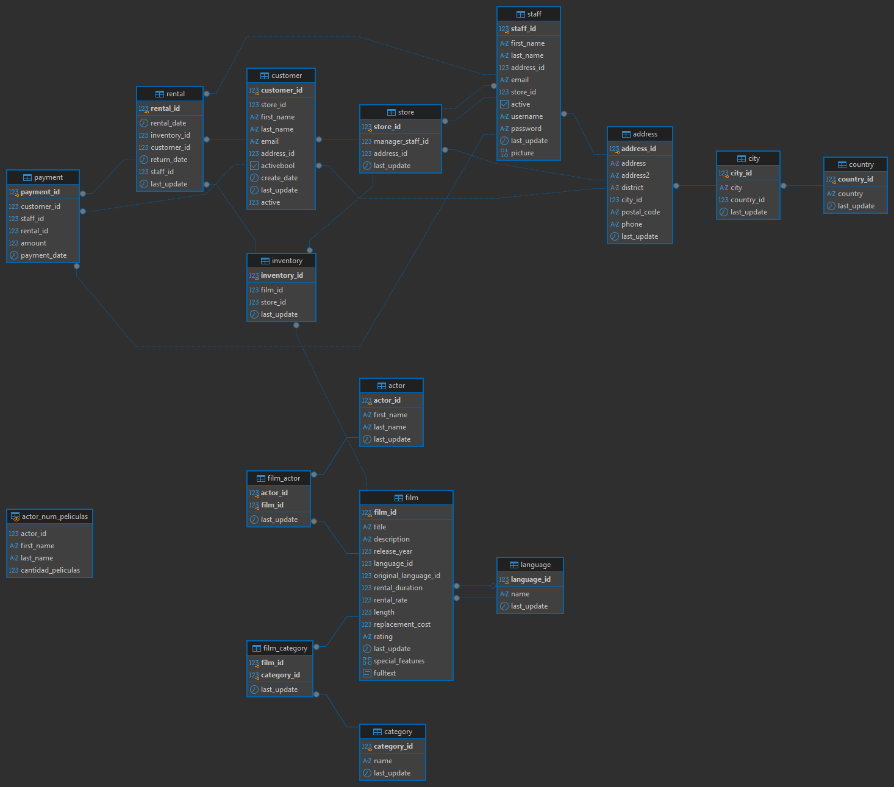

# Proyecto SQL: lógica y consultas

Resolución de los 64 ejercicios sobre una tienda de alquiler de películas, utilizando PostgreSQL y DBeaver. Se analizan las películas, los actores, los clientes, los alquileres y los pagos.

## Archivos

- `BBDD_Proyecto_shakila_sinuser.sql`: estructura y datos originales facilitados por el curso.
- `consultas_resueltas.sql`: ejercicios numerados, con su enunciado y solución.
- `esquema_bbdd.png`: diagrama de tablas y relaciones exportado desde DBeaver, correspondiente al ejercicio 1.
- `EnunciadoDataProject_SQL.Lógica.pdf`: enunciado del proyecto.

## Pasos seguidos

1. Crear una base de datos en PostgreSQL e importar el archivo facilitado por el curso.
2. Conectar la base de datos con DBeaver y revisar sus tablas, claves y relaciones.
3. Exportar el diagrama del esquema `public` desde DBeaver.
4. Resolver las consultas mediante filtros, uniones de tablas, agrupaciones y subconsultas.
5. Crear la vista del ejercicio 48 y las tablas temporales de los ejercicios 51 y 52.
6. Comprobar los resultados, los valores nulos y las comparaciones de texto.

## Cómo ejecutarlo

1. Crear una base de datos vacía en PostgreSQL y conectarla en DBeaver.
2. Ejecutar `BBDD_Proyecto_shakila_sinuser.sql` dentro de esa base de datos, una sola vez.
3. Abrir `consultas_resueltas.sql` con esa conexión y ejecutar los ejercicios en orden.

Las tablas temporales de los ejercicios 51 y 52 solo existen durante la sesión en la que se crean. Para consultarlas después, hay que mantener abierta esa misma conexión.

## Resultados y conclusiones

- Los pagos registrados suman **67.416,51** (ejercicio 15).
- **Julio de 2005** es el mes con más alquileres: **6.709** (ejercicio 25).
- **Sports** es la categoría más alquilada, con **1.179 alquileres** (ejercicio 61).

Los resultados permiten identificar el mes con mayor actividad y la categoría con más demanda. El total de pagos representa ingresos registrados, no beneficios, porque no se han analizado los gastos.

Las uniones permiten relacionar cada alquiler con su cliente y su película. Al contar películas distintas hay que evitar repetirlas por cada copia o alquiler. También es importante tratar los valores nulos y usar `ILIKE` cuando una búsqueda no debe distinguir mayúsculas y minúsculas.

## Esquema de la base de datos

El diagrama incluye las 15 tablas y la vista `actor_num_peliculas` del ejercicio 48.

